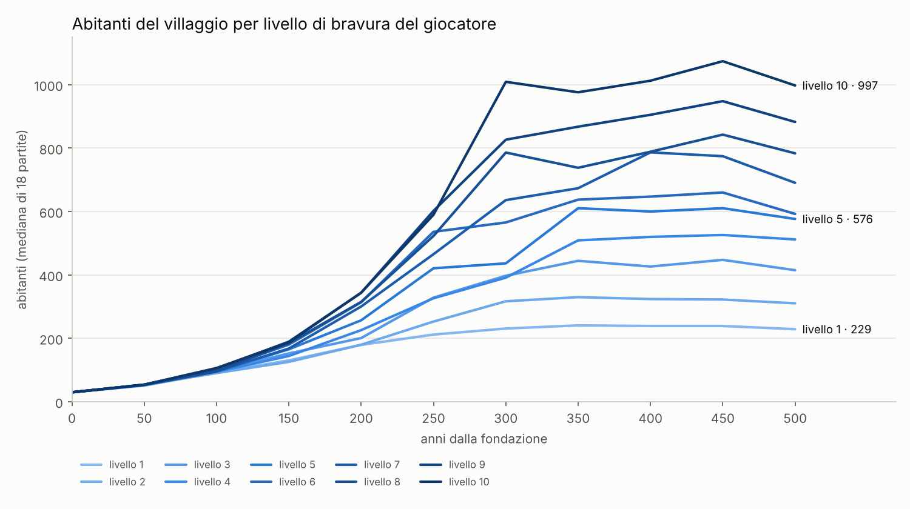
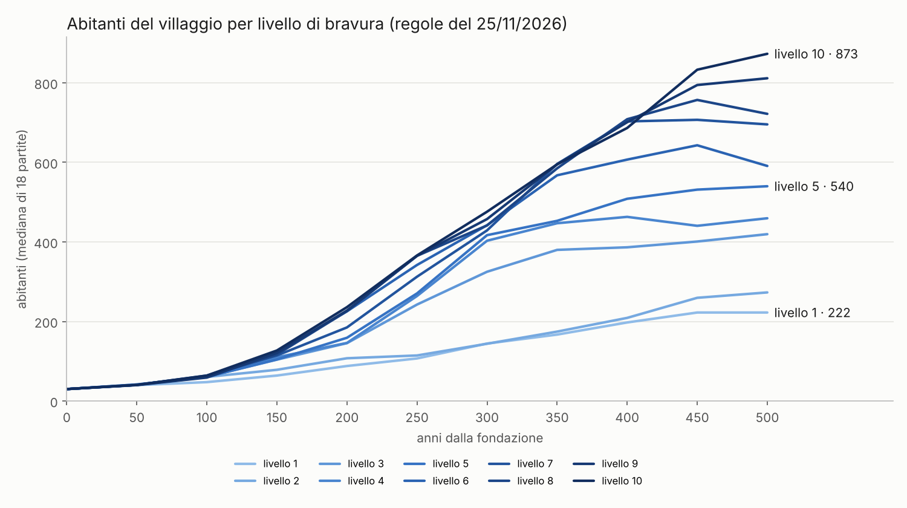

# Sessioni di gioco automatiche: dieci livelli di bravura

*24/11/2026. Richiesta di Fede: preparare sessioni di gioco a livelli di competenza diversi e vedere come procedono gli abitanti, perché lo scopo del gioco è creare una città e più abitanti è più successo (come in Cities: Skylines). Le proposte in fondo sono di Claude, da discutere.*

## Come sono fatte
- Script: `gioco/test/sessioni_giocatori.gd` (uso nella testa del file). Gioca soltanto la simulazione (`SimVillaggio`), senza grafica.
- **180 partite:** 10 livelli × 6 siti di fondazione × 3 semi, 500 anni ciascuna (6000–5500 a.C.). Nell'ambiente di Claude ci vogliono circa 25 minuti.
- **Cosa cambia con la bravura** (livello k da 1 a 10):
  - attenzione: ogni quanti anni il giocatore guarda la mappa (da 50 a 5);
  - zona agricola: quanta parte del contado copre (dal 46% al 100%); ai livelli 1–2 la si allarga solo quando arriva la notifica "zona piena"; dal 6 si evitano le terre a rischio di piena alto, dall'8 anche quelle a rischio medio, a meno che la terra sicura sia meno del 40%;
  - granaio dal livello 3; sentieri radiali collegati dal 5 (uno per livello oltre il 4, fino a 6);
  - scelte: la risposta giusta per la crescita con probabilità (k − 1) / 9, altrimenti una a caso (giuste: razionare con le sorgenti basse, ignorare la cometa, accogliere gli stranieri, restare quando c'è affollamento, cacciare o razionare al primo cattivo raccolto);
  - dal 6 la divisione del raccolto (alle famiglie se il consenso regge, altrimenti in comune); dal 7 la caccia sospesa quando la selvaggina crolla.
- Un difetto del giocatore automatico trovato strada facendo: sul Dosso nelle paludi i livelli 8–10, evitando tutta la terra a rischio di piena, restavano senza campi e morivano di fame. Corretto (accettano il rischio se la terra sicura è troppo poca) e rigiocato quel sito; gli altri risultati non cambiano.

## Risultati

| Livello | Abitanti a 500 anni (mediana) | Minimo – massimo | Massimo raggiunto (mediana) | Anni per arrivare a 300 | Partite oltre 1000 | Carestie per partita |
|---|---|---|---|---|---|---|
| 1 | 229 | 127 – 414 | 271 | 269 (6 partite su 18) | 0 | 8 |
| 2 | 310 | 146 – 451 | 360 | 236 (12/18) | 0 | 8 |
| 3 | 415 | 178 – 586 | 493 | 235 (15/18) | 0 | 24 |
| 4 | 512 | 207 – 628 | 608 | 237 (15/18) | 0 | 24 |
| 5 | 576 | 246 – 749 | 708 | 218 (16/18) | 0 | 23 |
| 6 | 592 | 260 – 798 | 824 | 192 | 0 | 29 |
| 7 | 690 | 319 – 871 | 924 | 200 | 6 | 24 |
| 8 | 783 | 323 – 1072 | 989 | 193 | 9 | 26 |
| 9 | 882 | 345 – 1034 | 1109 | 191 | 15 | 26 |
| 10 | 997 | 391 – 1212 | 1238 | 191 | 15 | 24 |

Nessun abbandono in nessuna partita.

**Per sito** (mediana a 500 anni, livello 1 → 10): Terrazzo centrale 246 → 1055; Sbocco del fiume 343 → 918; Sperone collinare 179 → 1081; Dosso nelle paludi 300 → 1042; Area dei gessi 127 → 396; Pianura aperta 211 → 988.

## Cosa si vede
1. **La bravura conta, e in modo regolare:** dal livello 1 al 10 gli abitanti finali crescono di oltre quattro volte, senza salti né inversioni. Il gioco premia chi gioca meglio.
2. **I primi 150 anni sono uguali per tutti:** a 100 anni ogni livello è tra 90 e 106 abitanti. Le scelte del giocatore cominciano a pesare solo dopo: nella prima parte della partita la bravura non si vede.
3. **Tetto verso i 300 anni:** tutte le curve si appiattiscono, e negli ultimi 100 anni calano un po' (il massimo raggiunto è sopra il valore finale a ogni livello). Il limite è la terra: il contado arriva al massimo a 800 m, e chi gioca bene lo riempie prima. Gli ultimi due secoli del villaggio scorrono senza crescita.
4. **Il sito pesa quanto la bravura:** nell'area dei gessi il giocatore migliore arriva a 396, meno di un giocatore di livello 3 sul Terrazzo centrale. La fondazione è davvero la decisione più importante.
5. **Carestie frequenti** dal livello 3 in su, circa una ogni 20 anni: chi spinge la crescita vive al limite. Non fanno abbandonare il villaggio, ma pesano sul ritmo meditativo.
6. **Confronto con la realtà:** per Çatalhöyük, il villaggio neolitico più grande conosciuto, le stime recenti (Kuijt e Marciniak, 2024) sono di 600–800 abitanti al massimo, contro i 3.500–10.000 delle stime precedenti. I nostri villaggi dal livello 7 in su lo superano. Quanto fossero grandi i villaggi neolitici comuni dell'Europa non l'ho verificato.

## Idee per gestire la crescita (proposte di Claude, da discutere)
L'obiettivo di Fede: più abitanti è più successo. Le idee cercano di tenerlo insieme alla verosimiglianza, senza togliere al giocatore il gusto di crescere.

1. **Il tetto apre l'epoca successiva.** Il tetto di terra che si vede a 300 anni diventa il motore: quando il villaggio riempie il contado, la pressione porta all'evento soglia "il metallo e lo scambio". Il giocatore bravo ci arriva prima e più grande; quello alle prime armi resta più a lungo nel villaggio. La durata dell'epoca diventa variabile, e gli ultimi due secoli senza crescita spariscono.
2. **Gli abitanti si contano sul territorio, non solo nel villaggio.** Oltre una certa densità le famiglie fondano casali nel contado: è lo sprawl che Fede ha già deciso come crescita di base. Il villaggio resta verosimile (qualche centinaio), il territorio ospita il resto, e nel protourbano i casali si uniscono nel centro (il sinecismo, il modo in cui sono nate molte città antiche). Il successo è la somma. A differenza del villaggio figlio tolto, i casali devono vedersi sulla mappa.
3. **Rendere la bravura visibile fin dall'inizio.** Oggi i primi 150 anni sono uguali per tutti: le prime scelte (sito, zona, caccia e pesca) dovrebbero già cambiare la velocità di crescita, così il giocatore vede subito l'effetto di ciò che fa.

## Registro degli avvisi di cinque partite (25/11/2026)
*Richiesta di Fede: vedere quali avvisi escono a schermo e nella cronaca, quanti sono e quanto pesano le piene.* Script `gioco/test/registro_avvisi.gd` (5 siti, giocatore di livello 5, 500 anni ciascuna).

| Per partita (media) | Quanti | Da cosa |
|---|---|---|
| Pause | 14 | stranieri 6, sorgenti 3, cometa 3, primo cattivo raccolto 1, affollamento 1 |
| Notifiche rosse | 12 | siccità 7, piene disastrose 4–5 |
| Notifiche grigie | 34 | "zona agricola piena" circa 10 (ogni 25 anni dopo il trecentesimo); piene di stagione solo sullo Sbocco del fiume (121 in quella partita) |
| Righe di cronaca | 86 | 29 rosse, quasi tutte "Carestia" |

- A 2 anni al secondo una partita dura circa 4 minuti: una pausa ogni 17 secondi circa.
- Le carestie sono 10–28 per partita, ma quasi tutte di pochi punti (manca l'1–20% del cibo): annate magre più che carestie.
- Le piene disastrose, pensate rare, sono circa 5 per partita su 4 siti su 5, ma pesano poco (34 case perse: circa 85 abitanti e −3 di consenso, recuperati in pochi anni).
- Le piene di stagione allagano in media l'8,6% dei campi una volta ogni 4 anni (circa il 2% del raccolto): oggi sono solo narrazione.
- Il consenso ha un solo effetto, la scissione sotto 5 per 4 anni; nelle cinque partite è sempre finito tra 56 e 63.

Le decisioni che ne sono venute (Fede, 25/11/2026) stanno in `pilastri-e-decisioni.md`, sezione "La prima epoca: dinamiche".

## Dopo le regole del 25/11/2026
*Le dinamiche decise da Fede il 25/11 (`era-origini.md`): abbondanza, tappe, legna, consenso per gruppi, eventi dallo stato della partita.* I giocatori automatici sono gli stessi; ai livelli 1–2 la zona si allarga quando la si vede piena sulla mappa (non c'è più la notifica).

**Registro degli avvisi** (5 partite, livello 5), per partita:
| | 24/11 | 25/11 | Obiettivo |
|---|---|---|---|
| Pause | 14 | 4,8 | 4–5 |
| Notifiche rosse | 12 | 2 | 3–4 |
| Carestie | 10–28 | 0 | 0–3 |
| Righe di cronaca | 86 | 37 | – |

**Sessioni a dieci livelli** (180 partite):

| Livello | 1 | 2 | 3 | 4 | 5 | 6 | 7 | 8 | 9 | 10 |
|---|---|---|---|---|---|---|---|---|---|---|
| Abitanti a 500 anni (mediana) | 222 | 278 | 419 | 459 | 540 | 591 | 695 | 722 | 811 | 873 |

- **La bravura conta ancora, in modo regolare**, e senza schiacciare chi gioca poco (livello 1: 222, prima 229).
- **Non c'è più il muro a 300 anni:** la crescita rallenta piano fino ai 450 anni, perché le nascite seguono l'abbondanza e la legna comincia a mancare sui siti con poco bosco.
- **Nessuna carestia** a nessun livello, nessun abbandono: il villaggio non è più punitivo. Forse troppo facile: da guardare nelle prove di Fede (traguardo: 0–3 carestie, solo per cause leggibili).
- **I primi 100 anni sono ancora uguali per tutti** (circa 60 abitanti): è la fase in cui "si mettono le pedine" (Fede, 25/11/2026). Il giocatore automatico non usa le leve dei primi anni (campi a mano, scelta delle fonti); da controllare con le prove vere.
- **Il sito pesa:** al livello 10 Pianura aperta 1168, Sperone 1098, Sbocco 914, Terrazzo 855; Dosso nelle paludi 481 (febbri, salute), Area dei gessi 452.
- **Abitanti ancora sopra l'obiettivo** del nucleo (100–300): servono i casali (tappa dei 250), cioè la scelta su come contare gli abitanti sul territorio, rimandata a epoca completa.

## Giocatori "umani" (25/11/2026)
*Richiesta di Fede: verificare le carestie con un giocatore che non conosce le dinamiche interne, ma impara sbagliando o fermandosi a leggere.* Script `gioco/test/giocatore_umano.gd`: vede solo ciò che vede il giocatore (indicatori rossi, cause dei pannelli di focus, tappe, scelte), stende all'inizio una zona a metà del contado senza guardare il rischio di piena, guarda la partita ogni 10–30 anni, prova i rimedi che le cause suggeriscono, risponde d'istinto alle scelte. Due profili: "sbaglia" (apre i pannelli 3 volte su 10) e "legge" (8 su 10). 36 partite (6 siti × 3 semi × 2 profili).

| Profilo | Abitanti a 500 anni (mediana) | Minimo | Carestie in tutto (18 partite) | Abbandoni | Senza granaio |
|---|---|---|---|---|---|
| Sbaglia | 516 | 216 | 2 | 0 | 9 |
| Legge | 704 | 200 | 0 | 0 | 6 |

- **Il risultato non cambia: le carestie restano quasi assenti** anche per chi sbaglia. Il motivo: quando la terra non basta, l'abbondanza ferma le nascite prima che arrivi la fame (il villaggio ristagna invece di morire), e le scorte coprono una siccità o una piena.
- **Leggere conta:** chi legge i pannelli arriva a circa il 40% di abitanti in più.
- **Un buco trovato:** la causa "mancano case: serve legna" non dice come procurarsela, e non c'è uno strumento per farlo (la legna viene da sola dai boschi vicini e dal dissodamento).

## Quattro giocatori "umani", con legnaia, carestie B + C e casali (25/11/2026, pomeriggio)
*Decisioni di Fede del 25/11/2026: legnaia obbligatoria per raccogliere legna, presagi ignorati che pesano di più e nascite in ritardo (carestie B + C), casali dalla tappa dei 250 abitanti; due profili nuovi: chi conosce il genere ma non legge e va a tentativi, e il casual che ripete gli errori e continua per il gusto di giocare. Le prove con i giocatori "umani" sono la base dei test futuri.* 72 partite (4 profili × 6 siti × 3 semi, 500 anni).

| Profilo | Abitanti a 500 anni (mediana) | Minimo | Carestie per partita | Carestie gravi (in tutto) | Abbandoni | Nucleo (mediana) | Casali (mediana) |
|---|---|---|---|---|---|---|---|
| Impara sbagliando | 743 | 251 | 0.7 | 2 | 0 | 280 | 4.5 |
| Legge le spiegazioni | 707 | 406 | 0.8 | 0 | 0 | 280 | 5 |
| Conosce il genere | 1172 | 502 | 1.3 | 3 | 0 | 280 | 13.5 |
| Casual | 162 | 83 | 2.7 | 0 | 0 | 162 | 0 |

- **Le carestie ci sono, quasi sempre leggere e con una causa leggibile.** Chi conosce il genere ne ha di più perché spinge la crescita (le nascite in ritardo lo portano oltre ciò che la terra regge); il casual ne ha di più perché non allarga la zona e non costruisce il granaio, ma il villaggio non muore: cresce lento fino a circa 160 abitanti e si continua a giocare.
- **Il nucleo resta entro i 280 abitanti**, il resto nei casali.
- **La legna è un limite vero:** una legnaia lontana dal bosco tiene il villaggio affollato; chi conosce il genere ne costruisce subito una vicino al bosco e un'altra quando rende poco.
- **Correzioni fatte durante la prova:** senza granaio le scorte si guastavano del 35% l'anno e le nascite in ritardo tenevano i villaggi sotto i 60 abitanti, la tappa del granaio (una trappola): ora il 30%; cibo che avanza pieno a 18 mesi (prima 24) e soglia della crescita a 60 (prima 62); le famiglie mettono nel conto il danno della selvaggina ai campi al margine del bosco; anche le paludi danno un po' di legna (metà del bosco).
- **Da guardare:** chi conosce il genere arriva a 1172 abitanti in tutto, sopra l'obiettivo di 600–800; chi impara sbagliando ha 0,7 carestie a partita (obiettivo 1–3).
